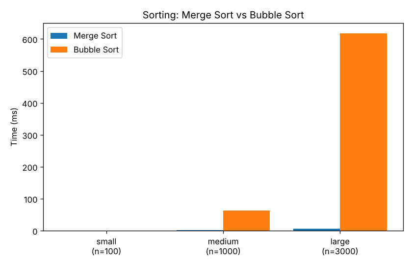
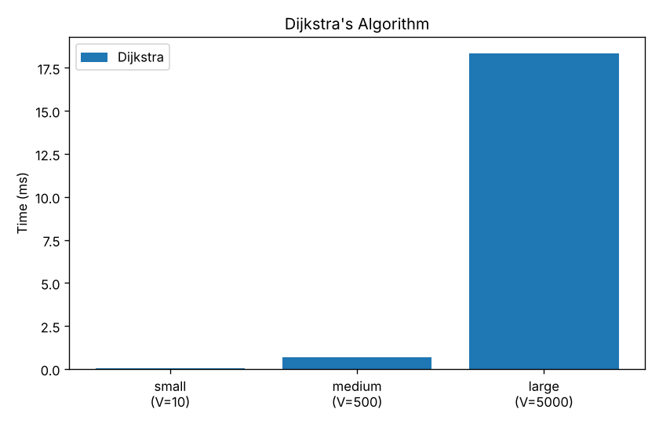
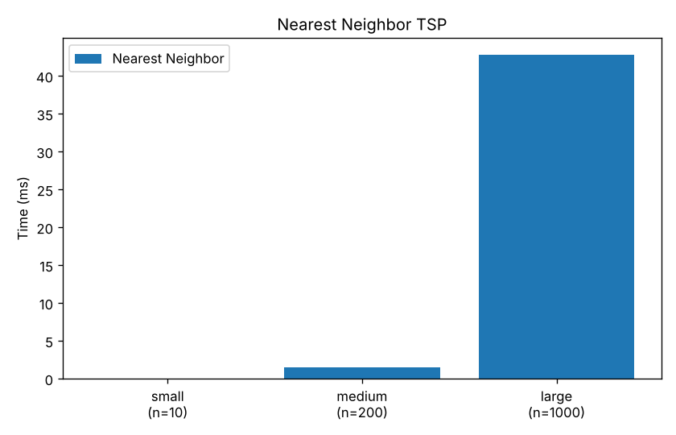
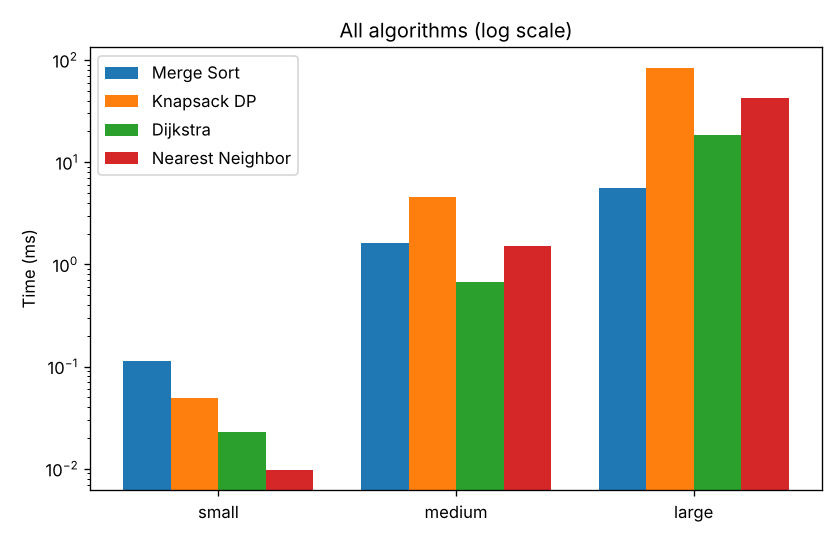
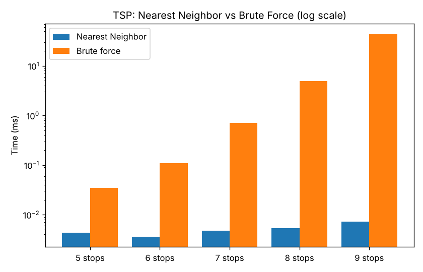

# Mini-Courier Planner
**Design and Analysis of Algorithms (ETCCDA302) - Capstone Assignment**

Name: ____________  Roll No.: ____________  Section: ____________

---

## 1. Introduction and Problem Statement

A courier company has a warehouse, a delivery vehicle and a list of parcels waiting to be delivered. The vehicle can only carry a limited weight, so not every parcel can go in one trip. The company needs to decide:

1. which parcels are most urgent,
2. which parcels should be loaded so that the most value is carried within the weight limit,
3. what the shortest roads between the delivery places are, and
4. in what order the places should be visited.

This project, the Mini-Courier Planner, solves these four questions in one program by combining sorting, dynamic programming, a shortest-path algorithm and a route approximation.

## 2. Objectives

- Design the courier problem and decide how parcels and the road map are stored.
- Sort parcels by priority and deadline using an efficient sorting algorithm.
- Use 0/1 Knapsack (dynamic programming) to select the best set of parcels for the vehicle.
- Use Dijkstra's algorithm to find shortest paths on the road graph.
- Use the Nearest Neighbor method to get a delivery route for the stops.
- Measure the running time of each algorithm on small, medium and large inputs and compare it with the theory.

## 3. Technologies Used

- Python 3 (standard library: `json`, `heapq`, `itertools`, `argparse`, `time`, `random`)
- Matplotlib - only for the runtime charts
- JSON files for the datasets

## 4. Problem Design and Data Representation

**Parcel attributes** (stored in `data/parcels.json`)

| Attribute | Meaning |
|---|---|
| id, name | identification |
| weight | whole kilograms, used as the knapsack weight |
| value | delivery charge in rupees, used as the knapsack value |
| priority | 1 (urgent), 2 (normal), 3 (low) |
| deadline_hours | hours left to deliver |
| location | delivery place (a node of the graph) |

**Road map** (stored in `data/locations.json`): the warehouse name and a list of roads `[place1, place2, km]`. All roads are two-way. In the program the map becomes an adjacency list, e.g. `graph["Cyber Hub"] = [("Udyog Vihar", 3), ("DLF Phase 3", 2), ("MG Road", 6)]`. The sample map has 10 places (including the warehouse) and 15 roads. An adjacency list was chosen because the road network is sparse (few roads compared with all possible pairs).

**Vehicle:** capacity 25 kg (can be changed). The vehicle starts and returns to the warehouse.

**Why these algorithms?**

| Sub-problem | Algorithm | Reason |
|---|---|---|
| Prioritise parcels | Merge Sort | guaranteed O(n log n), stable; Bubble/Insertion/Selection are O(n^2) |
| Choose parcels to load | 0/1 Knapsack DP | parcels cannot be split, and greedy choices can miss the best set |
| Shortest road between places | Dijkstra | all distances are non-negative; faster than trying all paths |
| Order of visiting stops | Nearest Neighbor | TSP is NP-hard, so an exact answer is too slow for many stops; NN is simple and fast |

**Design / data flow**

```
parcels.json ──► Merge Sort ──► Knapsack DP ──► selected parcels ──► stops (locations)
                                                                         │
locations.json ─► graph ─► Dijkstra (from warehouse + every stop) ──► distance matrix
                                                                         │
                                           Nearest Neighbor ◄────────────┘
                                                  │
                                  final route + total distance
```

## 5. Explanation of the Algorithms

### 5.1 Merge Sort (sorting)
Merge Sort splits the list into two halves, sorts each half recursively and then merges the two sorted halves by always taking the smaller of the two front elements. Parcels are compared using the pair `(priority, deadline_hours)`, so priority 1 parcels come first and, among equal priorities, the earlier deadline comes first. I chose Merge Sort over Quick Sort because its running time is O(n log n) in every case (Quick Sort can degrade to O(n^2)), and it is stable, so parcels with the same priority and deadline keep their original order.

### 5.2 0/1 Knapsack using Dynamic Programming
Let `table[i][w]` be the best total value using only the first `i` parcels when the weight limit is `w`. For parcel `i` there are two choices:

- skip it: `table[i-1][w]`
- take it (only if its weight <= w): `table[i-1][w - weight] + value`

`table[i][w]` is the larger of the two. The answer is `table[n][capacity]`. To find *which* parcels were chosen, we go backwards from the last row: if `table[i][w]` differs from `table[i-1][w]`, parcel `i` was taken, so we subtract its weight from `w` and continue. The DP table is printed in the program as evidence.

### 5.3 Dijkstra's Algorithm (shortest paths)
Dijkstra keeps the best known distance to every place (infinity at the start, 0 for the source). It repeatedly takes the closest place from a min-heap and checks whether going through it gives a shorter path to its neighbours (called relaxation). A `previous` dictionary remembers the road used, so the full path can be rebuilt. It works only when no road has a negative distance, which is checked when the graph is built.

### 5.4 Nearest Neighbor TSP
Starting at the warehouse, the route always goes to the closest stop not yet visited, and finally returns to the warehouse. It uses the distance matrix produced by Dijkstra. **This is only an approximation.** It makes the best choice at each step but never looks ahead, so the complete route may be longer than the best possible one. The exact best route can be found by trying all orders (brute force), which takes O(n!) time and is only possible for a few stops. The program does this comparison automatically when there are 8 stops or fewer.

## 6. Implementation and Integration

`main.py` runs seven steps:

1. **Load data** and check each parcel (missing fields, weight <= 0, unknown location, unreachable location are skipped with a message).
2. **Sort** the parcels with Merge Sort.
3. **Knapsack** is applied to the sorted list with the vehicle capacity.
4. The selected parcels are **grouped by location** to get the list of stops (two parcels for the same place need one stop).
5. **Dijkstra** is run from the warehouse (to print shortest paths) and from every stop to build the **distance matrix**.
6. **Nearest Neighbor** uses the matrix to get the stop order.
7. The stop order is expanded into the real road-by-road route using the `previous` information from Dijkstra, and the final plan is printed.

The output of each algorithm is the input of the next, so they are not independent programs.

## 7. Time and Space Complexity

n = parcels or stops, W = capacity, V = places, E = roads.

| Algorithm | Time | Space |
|---|---|---|
| Merge Sort | O(n log n) (best, average, worst) | O(n) |
| Bubble Sort (comparison only) | O(n^2) (O(n) if already sorted) | O(1) |
| 0/1 Knapsack DP | O(n x W) | O(n x W) for the table |
| Dijkstra (binary heap) | O((V + E) log V) | O(V + E) |
| Nearest Neighbor | O(n^2) | O(n) extra (matrix is input) |
| Brute-force TSP (comparison only) | O(n!) | O(n) |

In the integrated program Dijkstra runs once for the warehouse and once for each stop, so the total graph work is O(k (V + E) log V) for k stops. Knapsack is *pseudo-polynomial*: it depends on the value of W, not only on the number of parcels.

## 8. Sample Input and Output

Capacity 25 kg, 12 parcels (full parcel list in `data/parcels.json`). Full output is in `screenshots/output_trace_default_run.txt`.

**After Merge Sort (priority, then deadline):** P05, P02, P01, P09, P08, P12, P04, P07, P03, P06, P11, P10

**Knapsack result:**

- Selected: P05, P02, P01, P09, P08, P12, P07, P06 (8 parcels)
- Total weight: 25 / 25 kg
- Total value: Rs 4100
- Left for next trip: P04, P03, P11, P10

**Stops:** Cyber Hub (P01, P12), DLF Phase 3 (P06), Golf Course Road (P08), MG Road (P05), Sector 14 (P02), Sushant Lok (P09), Udyog Vihar (P07)

**Dijkstra from the warehouse (examples):**

```
Warehouse -> Cyber Hub          8 km   via Warehouse -> Udyog Vihar -> Cyber Hub
Warehouse -> Golf Course Road  16 km   via Warehouse -> Sector 14 -> MG Road -> Golf Course Road
Warehouse -> Sushant Lok       14 km   via Warehouse -> Udyog Vihar -> DLF Phase 3 -> Sushant Lok
```

**Nearest Neighbor route:**

```
Warehouse -> Udyog Vihar -> Cyber Hub -> DLF Phase 3 -> Sushant Lok -> MG Road -> Sector 14 -> Golf Course Road -> Warehouse
Total distance: 47 km
```

**Check against the exact answer (brute force, 7 stops):** best route = 37 km. Nearest Neighbor was 10 km (about 27%) longer. This shows that it is an approximation. (With capacity 15 kg the same program gave 29 km for both, so NN is not always worse.)

## 9. Performance Testing Methodology

- **Repeatable data:** `random.Random(42)` generates every test dataset, so the same inputs are produced on each run.
- **Timer:** `time.perf_counter()` before and after each call; the average of 5 runs is reported (3 runs for Knapsack, 1 run for Bubble Sort and brute force because they are slow).
- **Sizes:** each algorithm is run on a *small*, *medium* and *large* input. The input meaning is different for each algorithm, so the sizes are listed below.

| Dataset | Sorting (parcels) | Knapsack (parcels, capacity) | Dijkstra (places) | Nearest Neighbor (stops) |
|---|---|---|---|---|
| small | 100 | 10, 50 | 10 | 10 |
| medium | 1000 | 100, 500 | 500 | 200 |
| large | 3000 | 400, 2000 | 5000 | 1000 |

- **Random inputs:** parcels get random weight 1-20, value 10-500, priority 1-3. The graph is random but always connected, with about 4 roads per place. Stops for TSP are random points on a 100 x 100 map with straight-line distances.
- **Correctness checks** (run before timing, all passed): Merge Sort equals Python's `sorted()`; Knapsack equals brute force over all subsets (12 parcels); Dijkstra matches a hand-solved 4-node graph; Nearest Neighbor visits every stop once and is never shorter than the exact answer.
- Command: `python performance/benchmark.py`

## 10. Runtime Comparison Charts

Charts are in `report/charts/`. (Exact times change slightly from run to run, the trend does not.)








Results from one run (milliseconds):

| Algorithm | small | medium | large |
|---|---|---|---|
| Merge Sort | 0.114 | 1.600 | 5.634 |
| Bubble Sort | 0.567 | 63.298 | 618.291 |
| Knapsack DP | 0.049 | 4.533 | 84.400 |
| Dijkstra | 0.023 | 0.674 | 18.367 |
| Nearest Neighbor | 0.010 | 1.519 | 42.838 |

Nearest Neighbor vs brute force (random maps):

| Stops | NN time (ms) | Brute force (ms) | NN longer by |
|---|---|---|---|
| 5 | 0.004 | 0.035 | 19.4 % |
| 6 | 0.004 | 0.110 | 0 % |
| 7 | 0.005 | 0.700 | 0 % |
| 8 | 0.005 | 4.934 | 0 % |
| 9 | 0.007 | 43.901 | 0 % |

## 11. Results and Observations

- **Sorting:** when n grew from 1000 to 3000 (3 times), Merge Sort time grew about 3.5 times, which matches n log n. Bubble Sort grew about 10 times (close to 3^2 = 9), which matches n^2. At n = 3000 Bubble Sort was roughly 110 times slower than Merge Sort, so a good algorithm matters.
- **Knapsack:** the work is n x W. From medium to large it grows from 50,000 to 800,000 cells (16 times), and the measured time grew about 18 times.
- **Dijkstra:** even with 5000 places it took under 20 ms. Going from 500 to 5000 places (10 times) took about 27 times longer; the theory predicts a little more than 10 times, so the extra is probably Python's heap and memory overhead.
- **Nearest Neighbor:** 5 times more stops (200 to 1000) took about 28 times longer, close to 5^2 = 25 as expected for O(n^2).
- **Brute force vs NN:** brute force went from 0.035 ms (5 stops) to about 44 ms (9 stops), over 1000 times slower, because of the factorial growth, while NN stayed almost constant. This is the reason an approximation is used.
- **Quality of NN:** NN gave the best route in 4 of the 5 random tests, but was 19.4 % longer in one and 27 % longer on the sample courier map. So it is fast but not guaranteed to be optimal.
- The real planner on the sample data (12 parcels) finishes in a few milliseconds; the cost only becomes visible with thousands of items.
- The combined chart compares different kinds of inputs (e.g. 3000 parcels vs 5000 places), so it should be read as "how each algorithm grows", not as a fair race between them.

## 12. Limitations and Future Improvements

**Limitations**

- Nearest Neighbor ignores deadlines. In the sample run, P05 (priority 1, 2-hour deadline) is delivered near the end of the route even though it is the most urgent parcel.
- The sorted order only affects which parcel is chosen when two sets have the same total value. The knapsack itself uses weight and value.
- Only one trip is planned; the left-over parcels need a second run.
- Distances are used as travel cost; real traffic and travel time are not considered.
- Weights must be whole numbers for the DP table.

**Optimization / future ideas**

- Improve the NN route with a 2-opt step (swap two parts of the route if it becomes shorter).
- Add time windows so urgent parcels are visited early, or run NN only on the stops of priority-1 parcels first.
- Run Dijkstra only from the needed stops (already done) and cache the distance matrix if the same map is used many times.
- If only the best value is needed (not the parcel list), the Knapsack table can be reduced to one row, using O(W) space.
- Plan several trips automatically by repeating Knapsack on the left-over parcels.
- Use a faster language or NumPy for very large datasets.

## 13. Conclusion

The Mini-Courier Planner combines four algorithms into one working application. Merge Sort orders the parcels, Knapsack DP selects the best load, Dijkstra provides shortest paths on the road map and Nearest Neighbor builds the delivery route. The performance tests agree with the theoretical complexities: n log n for Merge Sort, n x W for Knapsack, (V+E) log V for Dijkstra and n^2 for Nearest Neighbor. The comparison with brute force also showed why an approximation is used for TSP, and that its answer may be longer than the best route.

## 14. Instructions to Execute the Project

1. Install Python 3 and run `pip install -r requirements.txt` (matplotlib is needed only for the charts).
2. Open a terminal in the `Mini-Courier-Planner` folder.
3. Run the planner: `python main.py` (optional: `--capacity 15`, `--parcels file.json`, `--locations file.json`).
4. Run the performance tests: `python performance/benchmark.py` (the charts are saved in `report/charts/`).
5. Sample outputs are saved in the `screenshots/` folder.
